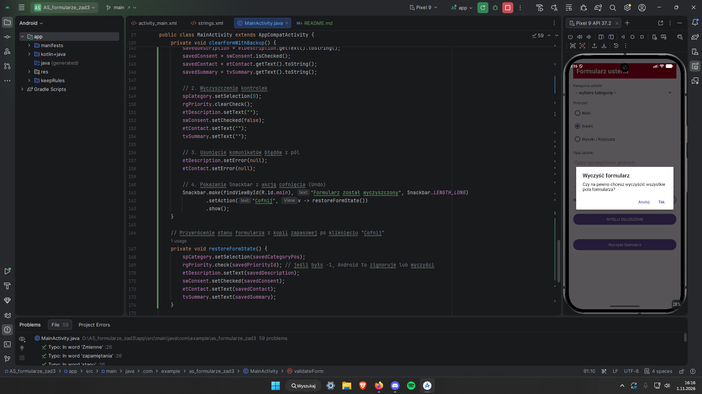

Jak rozwiązano mechanizm "Cofnij" (Undo) przy czyszczeniu formularza?

pole globalne pomocniczne stworzone. Zapisanie do kaopi zapasowej pól danych. Wyczyszczenie pól/kontrolek. wstawienie teksów/stanów w odpowiednie miejsca.

